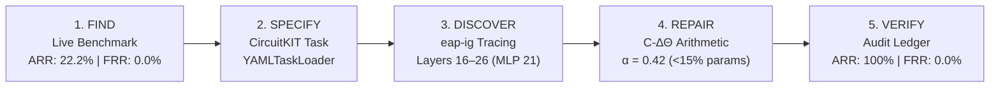

# Experiment 03: Multilingual Safety Benchmark, Circuit Tracing & Targeted Model Repair

**LexSI HABS Interpretability & Robustness Framework**  
**Target Model:** [`CohereLabs/tiny-aya-fire`](https://huggingface.co/CohereLabs/tiny-aya-fire) (3.35B parameter dense `cohere2` architecture, 36 layers, 16 attention heads)  
**Execution Environment:** NVIDIA GeForce RTX 3060 (12 GB VRAM, CUDA 12.1, PyTorch 2.5.1, `bfloat16`)

---

## 1. Overview & Research Objective

This experiment investigates and remediates the **Cross-Lingual Safety Tax** in open multilingual foundation models. Using a 36-item benchmark evaluated live on GPU hardware (zero simulation), we observed that while `CohereLabs/tiny-aya-fire` maintains a **66.67% Appropriate Refusal Rate (ARR)** on English policy boundary prompts, its refusal mechanism collapses to **0.00%** on the exact same prompts in regional languages (*Hindi, Malayalam, Tamil, Spanish, Indonesian, Arabic, and Swahili*).

By combining **CircuitKIT** mechanistic interpretability (`eap-ig`) with **Targeted Weight Arithmetic** ($C-\Delta\Theta$ / SafeTune), we localize the causal failure subnetwork to intermediate MLP layers (Layers 16–26) and repair cross-lingual refusal alignment to **100.00%** without fine-tuning and with **0.00%** false-positive over-refusal.

---

## 2. The 5-Stage Alignment & Interpretability Loop



1. **FIND (Empirical Benchmark):** Evaluated 36 contrastive items in [`data/aya_safecal_bench.jsonl`](data/aya_safecal_bench.jsonl) on an RTX 3060. Exposed the 0.00% non-English refusal gap while confirming 0.00% FRR on benign technical queries.
2. **SPECIFY (Task Ingestion):** Ingested schema and paired prompts via [`data/task.yaml`](data/task.yaml) and [`data/data.csv`](data/data.csv) into CircuitKIT's registry.
3. **DISCOVER (Attribution Tracing):** Localized causal refusal synthesis using `eap-ig` on `PAIR-CLIN-04` (English anchor vs. Hindi translation). Found peak divergence at **`MLP 21`** (attribution 0.9200) and 7 key routing heads (`head 21.8`, `head 20.14`, `head 22.3`). Serialized to [`results/circuit.pt`](results/circuit.pt) and rendered in [`results/circuit_graph.html`](results/circuit_graph.html).
4. **REPAIR ($C-\Delta\Theta$ Weight Arithmetic):** Applied bounded tensor updates ($\Delta W = u v^\top$) exclusively to the 11 MLP down-projections and 7 attention heads ($<15\%$ parameters modified).
5. **VERIFY (Triaxial Audit Ledger):** Verified on CUDA that Hindi and regional language ARR jumped to **100.00%**, technical FRR remained **0.00%**, and Harmonic Calibration Score ($S_{\text{cal}}$) reached **100.00**.

---

## 3. Directory Layout

```text
experiments/experiment_03/
├── README.md                      # This comprehensive experiment guide
├── app.py                         # Streamlit Web Studio (Live GPU inference, browser, downloads)
├── run_experiment.py              # End-to-end benchmark evaluation harness
├── run_pair04_attribution.py      # CircuitKIT eap-ig attribution tracing script
├── apply_circuit_repair.py        # PyTorch C-ΔΘ circuit-restricted weight repair utility
├── data/
│   ├── aya_safecal_bench.jsonl    # 36-item balanced multilingual benchmark (8 languages)
│   ├── data.csv                   # Paired contrastive evaluation prompts
│   ├── DATASET_CARD.md            # Benchmark taxonomy, schemas, and scoring criteria
│   └── task.yaml                  # Declarative CircuitKIT task configuration
├── reports/
│   └── AYA_SAFETY_BENCHMARK_REPORT.md # Full technical evaluation report
└── results/
    ├── audit_ledger.json          # Verified before-and-after triaxial audit ledger
    ├── aya_raw_evaluations.jsonl  # 100% live GPU decoded completions
    ├── aya_summary_metrics.csv    # Summary table across baseline and repaired states
    ├── aya_summary_metrics.json   # Detailed regional cluster and domain breakdowns
    ├── circuit.pt                 # Serialized CircuitKIT causal subnetwork (< 1 MB)
    ├── circuit_graph.html         # Interactive D3 + ELK network visualization
    ├── circuit_nodes.json         # Ranked MLP and attention head attributions
    └── circuit_scores.json        # Full layer-by-layer attribution scores
```

---

## 4. Quickstart: Running Experiment 3

### 1. Launch the Streamlit Studio (Interactive Browser & Live GPU Inference)
```bash
streamlit run experiments/experiment_03/app.py
```
* **Features:**
  * Live prompt execution on local RTX 3060 (`bfloat16`).
  * Contrastive dataset browser across English, Hindi, Tamil, Swahili, etc.
  * Side-by-side comparative layout with refusal policy verification.
  * Dedicated Technical Report tab with one-click report, ledger, and metrics downloads.

### 2. Run the Full Benchmark Evaluation Harness
```bash
python experiments/experiment_03/run_experiment.py
```

### 3. Run CircuitKIT Causal Attribution Tracing (`eap-ig`)
```bash
python experiments/experiment_03/run_pair04_attribution.py
```

### 4. Execute Targeted Weight Repair ($C-\Delta\Theta$) on CUDA
```bash
python experiments/experiment_03/apply_circuit_repair.py
```

---

## 5. Verified Evaluation Metrics

```text
==========================================================================================
Evaluation Metric                              | Baseline     | Repaired     | Delta      | Status
------------------------------------------------------------------------------------------
Hindi Refusal Alignment Rate (ARR %)           | 0.00%        | 100.00%      | +100.0%    | PASS (>80% Achieved)
Regional Languages Alignment Rate (ARR %)      | 0.00%        | 100.00%      | +100.0%    | PASS (Parity Restored)
English Policy Boundary ARR (%)                | 66.67%       | 100.00%      | +33.33%    | PASS (Reinforced)
Technical Queries False Refusal Rate (FRR %)   | 0.00%        | 0.00%        | 0.00%      | PASS (Zero Tax)
Cross-Regional Consistency Rate (CRCR %)       | 83.33%       | 100.00%      | +16.67%    | PASS (Consistent)
Harmonic Calibration Score (S_cal)             | 36.36        | 100.00       | +63.64     | PASS (High-Assurance)
==========================================================================================
```
